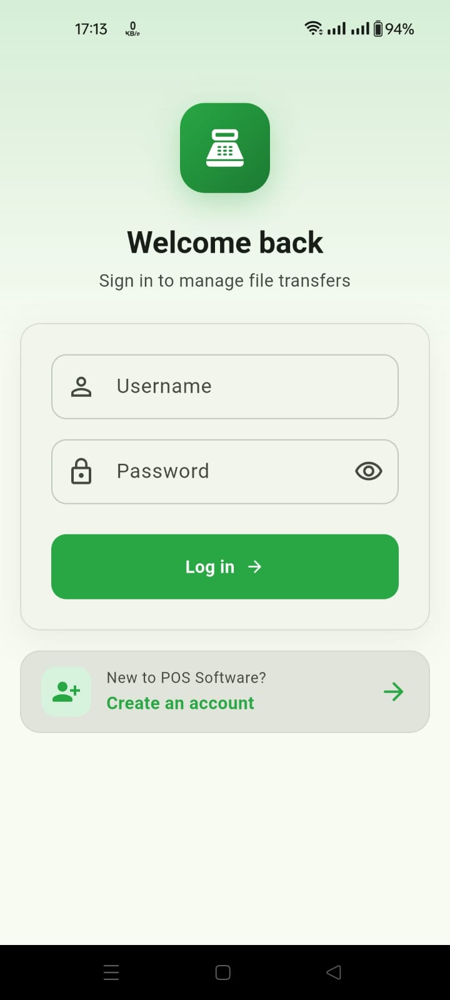
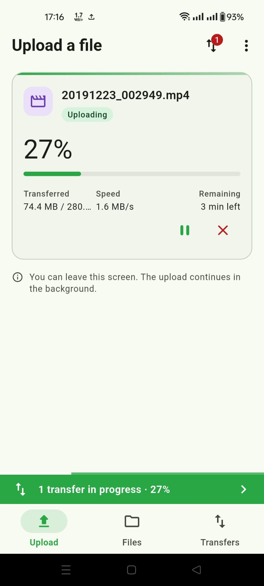
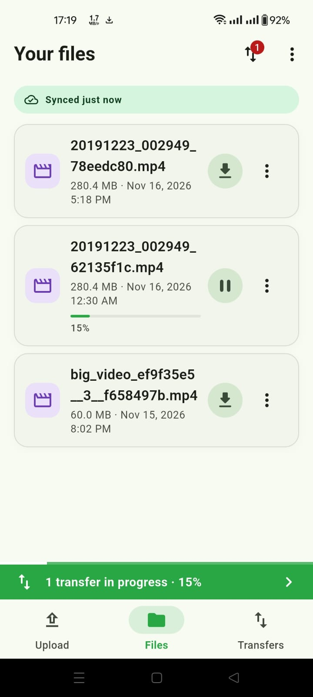
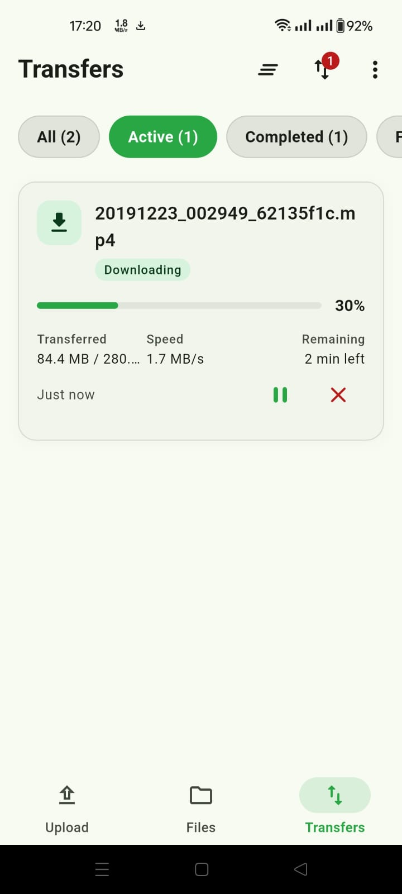
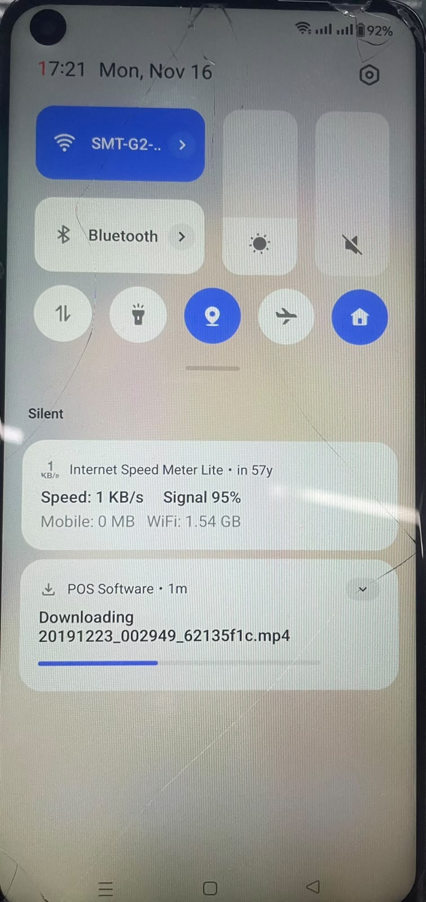

# POS Software

A Flutter POS (Point of Sale) app for uploading and downloading large files — product catalogs, audit exports, media — with background transfer support, real-time progress, and offline resilience.

Works on **Android** and **iOS**.

## Features

- **File upload** — pick any file and upload via multipart POST; runs in the background even when the app is minimised or terminated.
- **File download** — download previously uploaded files with background progress
- **Real-time progress** — percentage, progress bar, speed and ETA on every transfer
- **Pause & resume** — pause/resume downloads; uploads restart if the server doesn't support resuming (see below)
- **Background execution** — transfers continue via WorkManager (Android) / URLSession (iOS)
- **System notifications** — persistent tray notification with live progress; tapping it returns to the relevant screen
- **Offline handling** — transfers auto-pause on connection loss, auto-resume when back online
- **Central dashboard** — one screen listing all transfers with status, accessible from anywhere via a persistent mini-banner
- **Error handling** — user-friendly messages for network issues, server errors, invalid files, with retry options
- **File validation** — checks file type, size (max 512 MB), and empty files before uploading

## Running

**Requirements:** Flutter 3.47+ (Dart 3.13+), Android SDK 37, Xcode (for iOS)

```sh
flutter pub get
dart run build_runner build
flutter run
```

Server URL is in `lib/src/data/services/network/endpoints.dart` — change `Endpoints.baseUrl` to point to your server.

> **Account:** Tap **"Create an account"** on the login screen — the registration portal opens inside the app (no external browser needed).

## Issues Found & Fixed

1. **Upload pause/resume → server limitation** — Server only accepts one complete multipart POST. When paused or connection drops, upload restarts from zero. This is a **server-side limitation**. The app detects this automatically and warns the user on-screen before they pause. If the server ever supports resumable uploads, the app will use it without code change.

2. **Download pause/resume → works fully** — Server supports HTTP Range requests (`206 Partial Content`). Downloads pause and resume from the exact byte, even across app restarts.

3. **Connection loss destroyed partial downloads** — Transfers now park immediately on connection loss, keeping the partial file intact. Auto-resume when connection returns.

4. **"Online" didn't mean reachable** — `connectivity_plus` only reports interface status. A captive portal looks like working Wi-Fi. Now every check includes a server reachability probe with 15s re-check.

5. **Expired token on resume** — Downloads paused overnight resumed with an expired token. Now the session is re-read and header refreshed at resume time.

6. **Upload source file disappeared from cache** — File picker copies to cache directory, which Android can purge. Now the copy is moved to a safe directory (`upload_sources/`) before upload starts.

7. **No database migration** — No `onUpgrade` meant schema changes would crash existing installs. Now SQLite migrations run step by step.

8. **Flapping connection re-sent files endlessly** — Auto-restarts now capped at 3 per transfer; after that it waits for the user.

9. **Progress jumped to 0% on resumed uploads** — Native task only reports remaining bytes. Now progress is rebased onto the full file size.

## Working Offline

- File list is cached in **SQLite** — the app opens with real data even without internet, showing "Offline copy" in the sync bar
- Internet checking uses `connectivity_plus` + a server reachability probe — detects captive portals and dead routers
- Transfers auto-pause on connection loss (with reason shown) and auto-resume when back online
- Transfers that were queued offline start automatically when the connection arrives

## Architecture

```
lib/src/
  core/          Result, Failure, DI, config, constants, utils
  domain/        entities, repository contracts, use cases (pure Dart)
  data/          models, repository implementations, services
  presentation/  pages, widgets, blocs, router, theme
```

**Clean Architecture** — `presentation` never imports `data`; they meet only at the DI root. This makes testing easy and swapping implementations straightforward.

**BLoC (flutter_bloc)** — state management for auth, transfers, files, uploads, connectivity. Each transfer tile rebuilds independently via `BlocSelector`.

**`background_downloader`** — handles both uploads and downloads with native background execution, tray notifications, Range-based resume, and tap callbacks. Only one file imports the plugin — swapping it later is isolated.

**SQLite (`sqflite`)** — transfer history and file list survive offline. Progress stays in memory; only status changes hit disk.

**`Result<T, Failure>`** — no exceptions cross layer boundaries. Every error maps to a user-friendly message; no status codes or stack traces reach the screen.

## Transfer Flow (simplified)

```
User action → BLoC → Use Case → Repository → BackgroundTransferService (native)
                                                    ↓
                                              status/progress callbacks
                                                    ↓
                                              SQLite (persist) → BLoC → UI update
```

Each transfer has a stable app-level ID. The native task ID can change on retry/restart — events from replaced tasks are dropped so the dashboard never shows duplicates.

## Android & iOS

| | Android | iOS |
|---|---|---|
| Background | WorkManager foreground service | Background URLSession |
| Downloads folder | `Downloads/POS Software` via MediaStore | `Documents/Downloads` (visible in Files app) |
| Notifications | Full support, needs runtime permission (Android 13+) | Completion/failure only while suspended |
| Upload pause | Pauses (restarts if server can't resume) | Not supported by OS |

**Android platform limits:**
- **9-minute worker limit** — WorkManager kills ordinary workers at ~9 min; transfers run as a foreground service (`dataSync` type) to lift this
- **Doze / battery optimisation** — OEM battery managers (Xiaomi, Samsung, etc.) can still delay or kill foreground services; user may need to exempt the app
- **Force-stop** — cancels all pending work; stale tasks are marked failed after 2 min so they can be retried
- **Scoped storage** — downloads land via MediaStore into `Downloads/POS Software`, no permission needed
- **Notification permission** — required on Android 13+; asked on first transfer with rationale, not at launch; refusing doesn't block transfers

**iOS:** configured with background URLSession and `UIFileSharingEnabled`. Force-quitting from app switcher cancels pending transfers. Progress notifications can't update while suspended (completion/failure still fire).

## What's Not Finished

- **Upload resume** — server limitation; the app is ready, waiting for server-side support
- **HTTPS** — cleartext enabled only because the test server is HTTP; production needs TLS
- **No token refresh** — 24h token with no renewal endpoint; expiry sends user to login
- **Session storage** — currently in SharedPreferences; production should use Keystore/Keychain
- **iOS unverified** — configured but never built or device-tested (no Xcode available)

**With more time:** upload queue for batch imports, checksum verification after download, per-transfer settings (Wi-Fi only, priority), proper migration test suite as schema grows.

## CI/CD

GitHub Actions — runs on every push and PR to `main`.

| Step | What it does |
|---|---|
| **Analyze** | `dart format` check + `flutter analyze` |
| **Test** | `flutter test --exclude-tags golden --coverage` (318 tests; goldens run locally) |
| **Build APK** | `flutter build apk --debug` + uploads artifact |

Config: [`.github/workflows/ci.yml`](.github/workflows/ci.yml)

---

## Screenshots

<table>
  <tr>
    <td align="center"><b>Login</b></td>
    <td align="center"><b>Upload in Progress</b></td>
    <td align="center"><b>Files & Download</b></td>
  </tr>
  <tr>
    <td></td>
    <td></td>
    <td></td>
  </tr>
  <tr>
    <td>Sign in screen. Accounts created on web portal.</td>
    <td>27% upload · 74.4 MB / 280 MB · 1.6 MB/s · 3 min left. Pause/cancel buttons. Persistent banner at bottom shows global transfer status.</td>
    <td>Files tab with server file list. Download button per file. Active download shows inline progress bar (15%). Persistent banner stays visible across all tabs.</td>
  </tr>
  <tr>
    <td align="center"><b>Transfer Dashboard</b></td>
    <td align="center"><b>System Notification</b></td>
    <td></td>
  </tr>
  <tr>
    <td></td>
    <td></td>
    <td></td>
  </tr>
  <tr>
    <td>Transfers tab — central dashboard with filter chips (All / Active / Completed). Download at 30% · 84.4 MB / 280 MB · 1.7 MB/s.</td>
    <td>Persistent system-tray notification while app is backgrounded. Shows file name and progress bar. Tapping returns to the relevant screen.</td>
    <td></td>
  </tr>
</table>

---

## Packages & Why

| Package | Purpose |
|---|---|
| `flutter_bloc` / `bloc` | State management (BLoC pattern) |
| `equatable` | Value equality for BLoC states & entities |
| `get_it` | Dependency injection (service locator) |
| `go_router` | Declarative routing with deep-link support |
| `dio` / `retrofit` | HTTP client for API calls (login, file list, delete) |
| `dart_mappable` | JSON serialization/deserialization |
| `background_downloader` | Native background upload/download with notifications |
| `file_picker` | File selection from device storage |
| `connectivity_plus` | Network interface monitoring |
| `sqflite` | Local SQLite database for offline cache |
| `shared_preferences` | Session token storage |
| `permission_handler` | Runtime notification permission (Android 13+) |
| `url_launcher` | Open registration portal in browser |
| `webview_flutter` | In-app web content |
| `stream_transform` | Stream throttle/debounce for progress events |
| `mime` | File MIME type detection for validation |
| `intl` | Date/number formatting |
| `logger` | Debug logging |
| `path` | File path manipulation |

## Testing

Two kinds of tests, all run with `flutter test` (no device needed):

- **Unit tests** — logic, data and state layers: parsers, validators, formatters, SQLite DAOs, repositories, and BLoCs, all with mocked dependencies.
- **Widget tests** — UI and user flows: individual widgets plus integration-style flow tests that drive the whole app (upload, download, notification tap, offline recovery) against mocked repositories, and golden (pixel-snapshot) tests.

